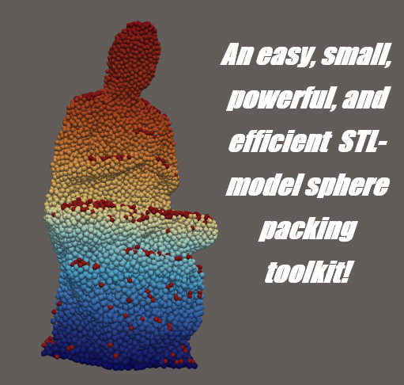

**The User guide might be obsolete.** Contact me at:

**hustler_lee@sjtu.edu.cn**

Backup mails:

2938304843@qq.com,

bohzan@yandex.ru.

It's easier to use the recommended faster branch in C++ language:

`main-cpp`

## User Guide

### Versions

- **C++ (recommended):** branch `main-cpp`. It is much faster than MATLAB. Use it for real runs.
- **MATLAB:** this branch (`main`). Use it to study and change the algorithm itself.

### Environment

- Windows 10/11 x64.
- **C++:** Windows PowerShell 5.1+, Visual Studio with x64 C++ build tools, Intel oneAPI DPC++/C++ Compiler (`icx-cl`, tested with 2025.2), CMake 3.24+, Ninja.
- **MATLAB:** MATLAB R2025a (tested). No extra toolbox needed.

### Dependencies

- **C++:** none beyond the C++20 standard library.
- **MATLAB:** `stlTools` (provides `stlRead`), installed from MATLAB Add-Ons. The Ray/Triangle and volume entries in the list below are not used by the code.

### Input

- Closed STL surface, ASCII or binary. Samples are in `inputs/`.
- Radius: one value for all spheres, or an ordered list.

### Run C++

Run from the root of the C++ version:

```powershell
.\scripts\Build.ps1                                  # build and run tests (-NoTest skips tests)
.\build\release\sphere_packing.exe --preset buddha   # Great Buddha, 44000 spheres (a few minutes)
.\build\release\sphere_packing.exe --model inputs\greatBudda\greatBudda.stl --radius 0.3 --count 1000 --output results\my_run
.\build\release\sphere_packing.exe --help            # all options
```

### Run MATLAB

Run from the repo root in MATLAB:

```matlab
testRun   % Great Buddha case. Edit testRun.m for your own STL, radii and options.
```

Or in a terminal from the repo root: `matlab -batch "testRun"`

Custom call:

```matlab
radii = repmat(0.3, 1000, 1);
options = struct('outputDirectory', 'results/my_run', 'outputPrefix', 'my_run');
[assembly, masses, totalVolume, inertia, report] = spawnSpheres('inputs/greatBudda/greatBudda.stl', radii, 60, 0, options);
```

### Output

Each run writes four CSV files:

- `<prefix>_spheres.csv`: id, x, y, z, radius, diameter, mass
- `<prefix>_summary.csv`: counts, stop reason, volume, inertia
- `<prefix>_grid_points.csv`, `<prefix>_grid_hexahedra.csv`: occupied grid cells, for visualisation

By default, `<prefix>` is the STL name and files go to the STL folder. The Buddha preset writes to `results\Great_Budda_cpp`, and `testRun` writes to `results\Great_Budda`.

If the spheres do not all fit, the run still succeeds with `stop_reason = capacity_reached`.

Dependences for MATLAB version:
---
Ray/Triangle Intersection version 1.0 (https://uk.mathworks.com/matlabcentral/profile/authors/1927554-jesus-p-mena-chalco)
Stl volume calculation versio 1.0 (https://uk.mathworks.com/matlabcentral/fileexchange/26982-volume-of-a-surface-triangulation) 
You need to going to the file, modify the definition of the function `rayTriangleIntersection` by adding another argument myEps (as the last) and set: `epsilon = myEps`.
stlTools version 1.1 (https://uk.mathworks.com/matlabcentral/profile/authors/402762-pau-mico)

References:
---
Li, Naiping, et al. "An efficient dense spheres packing method in complex domains for 3D DEM simulations." Powder Technology (2026): 122583.

Zhang, Duan Z., et al. "Rapid particle generation from an STL file and related issues in the application of material point methods to complex objects." Computational Particle Mechanics 11.5 (2024): 2291-2305.

Haeri, Sina. "Optimisation of blade type spreaders for powder bed preparation in Additive Manufacturing using DEM simulations." Powder Technology 321 (2017): 94-104.